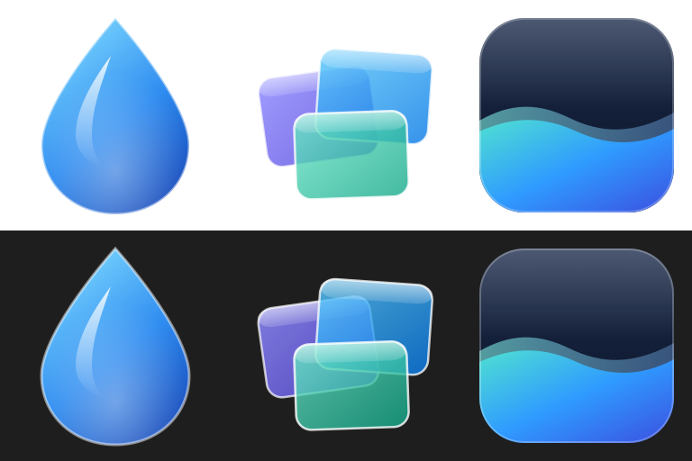

# Liquinix logo concepts (#10)

Three original concepts to choose from. All are drawn from scratch (SVG, no Apple or WacOS elements) and are GPL-3.0
with the project. Only one will be kept; the others get deleted when the choice is made.

| | Concept | Idea | Small sizes |
|---|---|---|---|
| A | `a-droplet.svg` | A glass water drop: the "liquid" in Liquinix | Reads well down to 16 px |
| B | `b-glass-panes.svg` | Three overlapping translucent windows: "Liquid Glass" and a desktop | Gets muddy below 32 px |
| C | `c-wave-tile.svg` | An app tile half filled with a liquid wave | Reads well down to 16 px; already icon-shaped |

Once one is chosen, #10 continues: the setup icon through `tools/recursos.ps1` (`LiquinixSetup`, `repo:<path>`), the
installer sidebar, the README header and the GitHub social preview.
